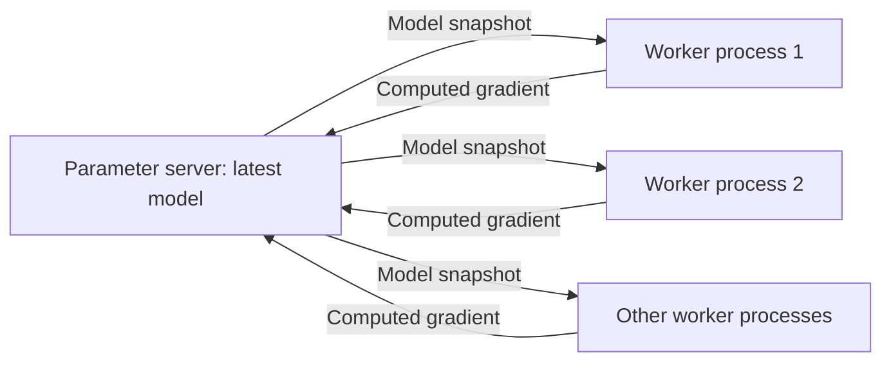

# Experimental findings and results report

**Project:** Delay-Robust Distributed Optimization — CSCI 8000, Optimization in AI.

We wanted to understand whether training can keep moving when some workers are
slow, and what happens when their results arrive late. This report explains the
setup and the results we measured, followed by short presentation notes.

## 1. What question are we trying to answer?

**When several workers help train a machine-learning model, what happens if some
workers are slow and return information about an older model?**

Imagine a group helping improve the same draft of a document. Everyone starts
reviewing a copy, but some people finish later. By the time a late review arrives,
the shared document may already have changed. The group can wait for everyone,
use every review immediately, or reject reviews that are too old.

We compared those choices during model training.

## 2. The basic words

| Word | Simple meaning |
| --- | --- |
| Dataset | The examples the model learns from. One row is one example. |
| Model | A mathematical rule that makes a prediction from an example's features. |
| Training | Repeatedly adjusting the model's numerical weights using examples. |
| Logistic regression | A simple model that predicts a probability for one of two categories. |
| Loss | A measure of prediction error. Lower loss is better. It is not an error percentage. |
| Accuracy | The percentage of examples classified correctly. Higher is better. |
| Gradient | A suggested direction for changing the model's weights, calculated from a batch of examples. A single suggested change does not guarantee improvement. |
| SGD | Stochastic gradient descent: repeatedly update the weights using gradients estimated from sampled examples. |
| Worker | A separate Python process that calculates a gradient. |
| Parameter server | The central process that keeps and updates the latest model. |
| Snapshot | A copy of the model taken when a worker receives its task. |
| Staleness | How many model updates happened between taking a snapshot and receiving its gradient. |
| Throughput | How many gradient results the server receives per second during training. |
| Seed | A number that fixes a random sampling sequence so the experimental setup can be repeated. |

For example, a task starts using model version 5 and arrives when the server is
at version 9. Its staleness is **9 − 5 = 4 updates**. Staleness is counted in updates,
not seconds.

## 3. What did we actually build?

We started with an event-driven simulation in Week 9: worker finishing times
were generated by the simulator. The extension uses actual Python worker processes,
actual datasets, and measured execution times. The earlier simulation is preserved.

The central process sends each worker a model snapshot. The worker samples training
examples, calculates a gradient using that snapshot, and returns the result. The
server decides whether to accept it and whether to update the model.

All of these processes run on **one computer**. This is real multiprocessing,
but it is not a cluster of separate physical machines.

A correctness detail matters: when an old gradient arrives, the server uses the
vector that the worker actually computed. It does not calculate a new gradient
and pretend the result came from the old snapshot.

## 4. The four methods

| Method | What it does | Main trade-off |
| --- | --- | --- |
| Synchronous SGD | Waits for every worker, then averages their gradients for one update. | Workers use the same model for each round, but a slow worker holds up everyone. |
| Vanilla asynchronous SGD | Uses each worker's gradient as soon as it arrives. | Fast workers keep making progress, but old gradients can be applied. |
| Delay-filtered asynchronous SGD | Uses an arriving gradient only if its staleness is at most a chosen threshold. | Rejects very old work, but rejected work still cost computation. |
| Simplified asynchronous mini-batch SGD | Collects four accepted gradients and averages them for one update; its threshold is 5. | Averages more information per update, but waits for the group to fill. |

For filtering, thresholds **2, 5, and 10** were tested. A gradient exactly at the
threshold is accepted. In mini-batching, four gradients need not come from four
different workers.

## 5. Which data did we use?

**Breast Cancer Wisconsin Diagnostic** is the small demonstration dataset:
569 examples and 30 features. Its quick experiment has 36 runs.

**Forest CoverType** is the main dataset: 581,012 examples and 54 features.
For this experiment the model answers one binary question:
**Is this example Lodgepole Pine, the original cover type 2, or another cover type?**
We are not predicting all seven original forest classes.

The CoverType split is:

- **406,708 training rows:** used to calculate gradients and learn weights.
- **87,152 validation rows:** used to observe performance on examples not used for learning weights.
- **87,152 test rows:** kept separate and scored after training.

Feature scaling is fitted using training rows only. Applying a scaler fitted on
all rows would leak information from the validation and test data into training.
Test scores are not used to choose the learning rate, stopping rule, or method.

## 6. What did we compare?

The main grid combines:

- **1, 2, 4, or 8 workers.**
- **Three delay conditions:** natural execution, moderate slow workers, severe slow workers.
- **Six variants:** synchronous, vanilla async, three filtering thresholds, and mini-batch.
- **Three random seeds:** 11, 22, and 33.

Therefore **4 × 3 × 6 × 3 = 216 main runs**. Together with the 36 quick runs,
there are **252 measured runs**.

Every main run has a nominal **3-second training budget**, learning rate **0.05**,
and worker batches of **1,024 sampled examples**. Samples can repeat. The full suite
took about 17 minutes because starting processes, final scoring, shutdown, and
writing results add costs beyond those training budgets.

Natural execution adds no artificial sleep. Moderate and severe conditions request
5 ms and 25 ms sleeps in the designated slow workers. Actual sleep and execution
durations are measured. With eight workers, two are designated slow; with four,
one is slow. With one or two workers, one is slow, so the slow-worker fraction
is not identical at every worker count.

## 7. What did the experiment find?

The following table is for **8 workers under severe delays**, averaged over the
three seeds. Validation accuracy is expressed as a percentage. “Stale work rejected”
counts stale rejections among in-budget arrivals; it excludes work returned after
training stopped.

| Method | Training loss ↓ | Validation accuracy ↑ | Gradients/second ↑ | Stale work rejected |
| --- | ---: | ---: | ---: | ---: |
| Synchronous | 0.57183 | 71.02% | 220.5 | 0.00% |
| Vanilla asynchronous | 0.51596 | 75.63% | 10,474.9 | 0.00% |
| Filtered, threshold 2 | 0.51596 | 75.68% | 10,969.7 | 48.97% |
| Filtered, threshold 5 | 0.51594 | 75.67% | 10,797.8 | 16.07% |
| Filtered, threshold 10 | 0.51595 | 75.68% | 10,668.5 | 0.94% |
| Asynchronous mini-batch | 0.51588 | 75.68% | 11,389.9 | 0.56% |

### Finding A: waiting for slow workers can strongly reduce progress

Under severe delays, synchronous SGD waits for its slowest workers each round.
Vanilla async lets the fast workers continue. In these short runs, synchronous
SGD ended with training loss around **0.572**, while vanilla async ended around
**0.516**. Their validation accuracies were around **71.0%** and **75.6%**.

This supports the practical observation that waiting can be expensive under worker
imbalance. It does not prove that asynchronous SGD is always the better optimizer.
The methods processed different amounts of work and used different update batches.

### Finding B: more workers do not guarantee proportional speedup

Under natural execution, vanilla async received approximately:

| Workers | Gradients per second |
| ---: | ---: |
| 1 | 4,046 |
| 2 | 7,244 |
| 4 | 10,386 |
| 8 | 10,322 |

Throughput increased up to four workers and then flattened. Processes share the
same computer and create coordination overhead. The small difference between four
and eight workers is not evidence that four workers are universally optimal.

### Finding C: average staleness can hide very old gradients

For vanilla async with eight workers, average staleness stayed close to seven
updates in both natural and severe conditions. However, the **average per-run
maximum** increased from about **24.3** updates to **391.3** updates.

That means the average age did not reveal the full effect of slow workers. A few
very old gradients can matter even when the average changes little. The maximum
numbers here average the largest value from each of the three runs; they are not
one exact observed task age.

### Finding D: strict filtering can discard substantial work

Under the same eight-worker severe condition, thresholds 2, 5, and 10 rejected
about **49.0%, 16.1%, and 0.94%** of in-budget gradients as stale.

Their final losses were very close. A stricter threshold therefore did not produce
a clear large improvement in this setup. Filtering creates a trade-off between
avoiding old information and wasting completed computation.

The mini-batch method had a slightly lower mean loss in this table. We should not
claim a statistically established winner from that small difference and three seeds.

## 8. How do we make the comparison fair?

**More updates alone do not mean better learning.** At eight workers:

- Synchronous SGD averages eight gradients: **8,192 example samples per update**.
- Vanilla async and filtered async use **1,024 samples per update**.
- Mini-batch averages four gradients: **4,096 samples per update**.

An update is therefore a different amount of work across methods. We inspect loss
against four progress measures: real time, applied updates, gradients computed,
and examples processed. Examples processed includes repeated samples and wasted work.

A discarded gradient still used time and computation. An accepted gradient in an
unfinished mini-batch is counted as pending rather than applied. Tasks returned
after the training budget are recorded and discarded without changing the model.

Also, **loss 0.516 does not mean 51.6% of predictions are wrong**. Loss and accuracy
are different measures. Accuracy is the percentage-correct column in the table.

## 9. Graphs for the presentation

1. [Training loss versus time](plots/real_workers/01_training_loss_vs_time.png).
   Explain that lower loss is better and the clock measures real training time.
2. [Worker count versus throughput](plots/real_workers/03_worker_scaling.png).
   Show that adding workers does not give unlimited proportional speedup.
3. [Staleness](plots/real_workers/04_gradient_staleness.png) and
   [threshold comparison](plots/real_workers/05_threshold_comparison.png).
   Explain the balance between accepting old information and discarding work.
4. [Worker timeline](plots/real_workers/10_worker_timeline.png).
   The bars and receipt ticks come from actual process timestamps.

Curves interpolate recorded measurements. Shaded bands and error bars, where shown,
describe variation across seeds using sample standard deviation. They are not proof
of statistical significance. The quick suite has only one seed and cannot estimate
across-seed variability.

The simulation-comparison figure has different data and different time units in
its two panels. It cannot be used to calculate a real-world speedup.

## 10. Checks we ran

- **39 automated tests passed**, covering real processes, gradients, snapshot copies,
  waiting behavior, filtering, batching, deadlines, data preparation, and shutdown.
- An independent audit checked **4,181,298 returned gradients** across both suites.
- All **252 saved final models** were independently scored again, and their training,
  validation, and test scores matched the saved results within numerical tolerance.
- Dataset fingerprints, seeds, configurations, package versions, hardware information,
  and the source files used for the measured runs are preserved.

Fixed data splits and random sampling streams help repeat the setup. Operating-system
scheduling still changes arrival order and timing, so exact asynchronous results are
not guaranteed to repeat bit for bit.

## 11. A short script to say to the professor

> This project studies what happens when some workers are slower than others during
> machine-learning training. A slow worker can return a gradient calculated from an
> older version of the model. We call the number of updates since that version its
> staleness.
>
> The earlier project used a simulation. The extension runs actual Python worker
> processes with a central parameter server and measures real execution time. All
> workers are on one computer; this is not yet a multi-machine cluster.
>
> We compared synchronous SGD, vanilla asynchronous SGD, delay-filtered asynchronous
> SGD, and a simplified asynchronous mini-batch method. Synchronous SGD waits for
> everyone. Vanilla async uses each result immediately. Filtering rejects results
> that are too old. Mini-batching averages four accepted gradients per update.
>
> We used Breast Cancer data for a quick demonstration and Forest CoverType for the
> main experiments. The main task is binary classification: Lodgepole Pine versus
> the other cover types. Training, validation, and test data are separate, and scaling
> is fitted only on training data.
>
> There were 216 main runs: four worker counts, three delay conditions, six method
> variants, and three random seeds. The methods used the same initialization and a
> common learning rate within that experiment.
>
> Under severe delays, waiting substantially reduced synchronous progress in these
> short runs. Asynchronous methods let fast workers continue, but they also received
> old gradients. The average age alone was not enough: the tail of the age distribution
> increased substantially when workers were slow.
>
> We also found that increasing workers from four to eight did not proportionally
> increase throughput. Strict filtering discarded a lot of work without a clear large
> improvement in final loss in this setup.
>
> We do not rank methods just by update counts, because their effective batches are
> different. We compare loss against time, gradients, examples, and updates. The results
> are supported by 39 tests, event accounting checks, and independent model rescoring.
>
> The main limitations are short training budgets, one computer, three seeds, unequal
> batch sizes, and one main binary task. Longer runs, matched batches, more seeds,
> spatial forest-data holdouts, and separate physical machines are the next steps.

This script is an introduction. Use the saved graphs for the rest of a 5–7 minute
presentation; [professor_demo.md](reports/demo.md) gives the timed walkthrough.

## 12. Questions the professor may ask

**Are these simulated workers?**
The older Week 9 work is a simulation. The new measurements use separate real Python
processes. The moderate/severe conditions deliberately add sleep to those processes.

**Is this a distributed cluster?**
No. It is a single-machine parameter-server architecture using multiprocessing.
Networked multi-machine execution has not been tested.

**Why not always use the strictest threshold?**
A strict threshold can reject a large share of completed computation. Whether that
helps depends on the task, timing, learning rate, and amount of work retained.

**Why only three seconds of training per main run?**
These are short systems experiments that expose timing and stale-work behavior for
a small logistic-regression model. They do not establish long-run convergence or
production performance. Longer budgets are an explicit next experiment.

**Which method is best?**
There is no universal winner established here. Read the measured loss, accuracy,
throughput, and rejection rate together. Effective batches differ and three seeds
are not enough to claim that tiny loss differences establish superiority.

**Did you reproduce the complete Ringmaster or adaptive mini-batching paper?**
No. The implementation studies simplified fixed-threshold filtering and fixed-size
asynchronous batching inspired by those ideas. It does not claim the papers'
theoretical optimality guarantees.

**What does 75.6% accuracy mean?**
About 75.6% of validation examples were correctly classified for the declared binary
forest task. It is not accuracy for all seven cover types or proof of performance
on another location or dataset.

**What should I say if I do not know an implementation detail?**
Explain what was actually tested, and say when something has not been tested. Use
the source code and the detailed report to check rather than guessing.

## Sources within this repository

- [Full experimental report](reports/real_worker_experiment_report.md).
- [Verification summary](reports/verification_summary.md).
- [Measured full results](results/real_workers/raw_results.csv).
- [Recorded experiment configuration](results/real_workers/experiment_config.json).
- [Main README](README.md) for installation and reproduction commands.
