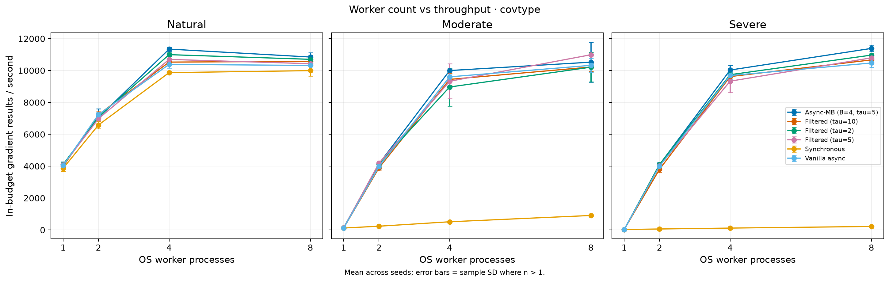

# Delay-Robust Distributed Optimization

**CSCI 8000 — Optimization in AI · Master's research project**

We study what happens when several workers train the same model but finish their
work at different times. Waiting keeps the workers synchronized, but a slow worker
can hold everyone up. Asynchronous training keeps moving, although some gradients
arrive after the model has changed.

We first explored this with a simulation. The current version uses separate Python
processes, real datasets, and measured execution times on one computer.

## Start here

- [Project explanation and speaking notes](Experimental%20findings%20and%20results%20report.md) — a plain-language introduction.
- [Experiment report](reports/real_worker_experiment_report.md) — setup, results, and limitations.
- [Professor demo](reports/demo.md) — a 5–7 minute walkthrough.
- [Verification summary](reports/verification_summary.md) — tests and independent checks.

## Run the project

Use Python 3.10 or newer. From the project directory:

```bash
python -m venv .venv
source .venv/bin/activate
python -m pip install -r requirements.txt
python -m pytest -q
python run_real_workers.py --quick
python run_real_workers.py --full
python generate_real_worker_plots.py
streamlit run dashboard/app.py
```

The first full run downloads CoverType. Existing measurements are preserved:
repeating a default experiment command saves a timestamped run under
`results/real_workers/runs/`. The dashboard also lists those runs.

| Mode | Data | Workers | Seeds | Training time/run | Examples/worker batch | Runs |
| --- | --- | --- | --- | --- | --- | --- |
| Quick | Breast Cancer | 1, 4 | 11 | 0.8 seconds | 128 | 36 |
| Full | Complete CoverType | 1, 2, 4, 8 | 11, 22, 33 | 3 seconds | 1,024 | 216 |

Every mode includes natural execution, moderate delays, severe delays, and six
method variants. Moderate/severe conditions request 5/25 ms sleeps in the last
`max(1, floor(workers/4))` workers; natural execution adds no sleep.

For a longer run, choose a new output directory:

```bash
python run_real_workers.py --full --time-budget 10 --output results/real_workers/longer_run
python generate_real_worker_plots.py --results results/real_workers/longer_run --output plots/longer_run
```

## Methods

| Method | What happens at the server |
| --- | --- |
| Synchronous SGD | Wait for all workers, average the round, then update. |
| Vanilla asynchronous SGD | Apply each returned gradient immediately. |
| Delay-filtered asynchronous SGD | Accept gradients with staleness at most 2, 5, or 10. |
| Simplified asynchronous mini-batch SGD | Average four accepted gradients per update, with threshold 5. |

A worker calculates its gradient from a copied model snapshot. The server uses
that returned gradient; it does not recompute it using newer weights. Staleness is
the number of applied model updates since the snapshot was taken.

## Data

Breast Cancer Wisconsin Diagnostic is our small demonstration dataset: 569 rows
and 30 features. Forest CoverType is the main dataset: 581,012 rows and 54 features.
We use binary logistic regression to predict **Lodgepole Pine (cover type 2) versus
all other cover types**, rather than predicting all seven original classes.

Both datasets use fixed stratified 70/15/15 training, validation, and test splits.
Scaling is fitted on training data only. All models start at zero, with learning
rate 0.05 and L2 regularization 0.001. Sampling uses reproducible per-worker streams;
operating-system scheduling still changes asynchronous arrival order and timing.

## Results and figures

<!-- REAL_WORKER_FINDINGS_START -->
On the recorded Apple M2, vanilla async's natural-execution throughput was 4,046, 7,244, 10,386, 10,322 gradients/s for 1, 2, 4, and 8 workers. Throughput flattened between 4 and 8 workers.

With 8 workers and severe delays, mean final training loss was 0.57183 for synchronous SGD and 0.51596 for vanilla async. Effective batches and total work differ, so these are not batch-matched optimizer rankings.

Vanilla async's mean maximum staleness increased from 24.3 updates under natural execution to 391.3 under severe delay, while mean staleness stayed near seven. These are descriptive three-seed results from short local runs.
<!-- REAL_WORKER_FINDINGS_END -->



The full results are in [the report](reports/real_worker_experiment_report.md) and
[the generated summary](results/real_workers/experiment_summary.md).
`plots/real_workers/` contains 11 figures, each as PNG and PDF: loss/time,
validation accuracy/time, throughput, staleness, thresholds, slow workers,
simulation comparison, loss/gradients, loss/examples, worker timeline, and loss/updates.

## How to read the results

These are short experiments using real processes on **one physical machine**.
They do not measure a networked cluster. Periodic model evaluation counts toward
the training budget; startup, final evaluation, draining, and shutdown are measured
separately. End-to-end time includes those phases.

The methods have different effective batches. Synchronous updates use workers ×
worker batch size, vanilla/filtered updates use one batch, and mini-batch updates
use four. We therefore compare loss against time, updates, gradients, and examples.
More updates alone do not establish better optimization.

Gradients returned after stopping are recorded without updating the model.
Rejected work still counts as computation, and incomplete accepted groups remain
pending. Three seeds give descriptive mean/SD comparisons, not a statistically
established winner. Random row splits also limit claims about new geographic areas.

## Files that matter

| Location | Contents |
| --- | --- |
| `real_workers/` | Process workers, parameter server, data preparation, experiments, and plotting. |
| `dashboard/app.py` | Interactive results explorer; values come from measured CSVs. |
| `results/real_workers/` | Full CSVs, configuration, hardware, final models, and audit reports. |
| `results/real_workers/quick/` | Small demonstration results. |
| `plots/real_workers/` | Main presentation figures in PNG and PDF. |
| `reports/` | Research report, explanation, demo, presentation outline, semester progress, and checks. |
| `src/`, `experiments/`, `main.py` | Original simulation and shared logistic-regression/update code. |
| `archive/week9/` | Original simulation report, README, and lossless archive of old results and figures. |
| `archive/quick_demo/` | Earlier quick-run figures, kept together instead of duplicating the main plots. |

Large gradient logs are versioned as lossless compressed CSV parts, with checksums,
under `gradient_event_parts/`. The expanded CSVs remain available locally.
The plotter reads either form. These logs and source snapshots are kept because
they let us audit the measurements.

```bash
python scripts/real_worker_artifacts.py --results results/real_workers --verify
python scripts/verify_real_worker_models.py --results results/real_workers
python scripts/real_worker_artifacts.py --results results/real_workers --restore-events
```

`requirements-real-workers-lock.txt` records the measured environment.
`requirements-lock.txt` is retained for the earlier simulation. The archived
simulation outputs and quick figures were checked byte-for-byte before consolidation.
See [the archive notes](archive/week9/README.md) for inspection and reproduction.

## Research background

Our filtering and batching experiments are inspired by:

- Attia, Gaash, and Koren, [Faster Stochastic Optimization with Arbitrary Delays via Adaptive Asynchronous Mini-Batching](https://proceedings.mlr.press/v267/attia25a.html), ICML 2025.
- Maranjyan, Tyurin, and Richtárik, [Ringmaster ASGD: The First Asynchronous SGD with Optimal Time Complexity](https://proceedings.mlr.press/v267/maranjyan25b.html), ICML 2025.

We use simplified fixed thresholds and batch groups. We do not claim to reproduce
the complete theoretical algorithms or their optimality guarantees.
